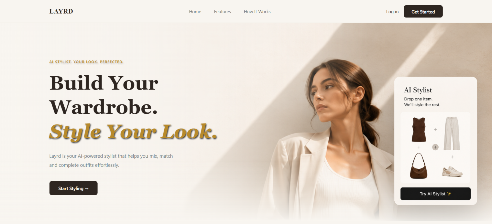

# Layrd 👗✨

> **Digitize your wardrobe. Build outfits visually. Get AI styling suggestions.**

Layrd is a full-stack MERN styling tool that helps users figure out if an outfit combination actually works — before buying anything. Pick a silhouette, build the look on an interactive canvas, and let the AI complete missing pieces using only items available in the catalogue.

------------------------------------------------------------------------

# 🚀 Live Demo

**Live Link:** *[Click Here](https://layrd-eight.vercel.app)*

------------------------------------------------------------------------

## 📸 Screenshots

### 🏠 Landing Page


### 👗 Clothing Library


### 🎨 Outfit Builder


### 🤖 AI Stylist


### 🧥 My Wardrobe


------------------------------------------------------------------------

## ✨ Features

### 🔐 Authentication
- User Registration & Login
- JWT Authentication
- Password Hashing with bcrypt
- Protected Routes
- User-specific saved outfits

### 👗 Clothing Library
- Browse curated clothing inventory
- Category filtering
- Search clothing items
- Rich clothing metadata including style, occasion, season, color, formality, fit, and material

### 🎨 Outfit Builder
- Drag-and-drop interactions on desktop
- Tap-to-select interactions on mobile
- Four dedicated outfit slots: Top, Bottom, Shoes, and Accessory
- Category validation
- Replace and remove items
- Clear outfit canvas
- Save outfits
- Automatically clear previous recommendations when starting a new outfit

### 🧥 My Wardrobe
- View saved outfits
- Outfit preview cards
- Delete saved outfits
- User-specific wardrobe persistence

### 🤖 AI Stylist
- Powered by the Groq API
- Detects missing outfit categories
- Generates outfit combinations using available wardrobe items
- Prevents recommendations outside the available inventory
- Considers style and occasion combinations
- Returns multiple outfit candidates

### 📊 Outfit Recommendation Scoring

Recommendations are evaluated using a multi-factor scoring system considering:

- Style compatibility
- Occasion suitability
- Color compatibility
- Formality consistency
- Outfit fit harmony
- Seasonal suitability

Recommendations are ranked based on their final outfit score.

### 📱 Responsive Experience
- Responsive UI across desktop and mobile
- Drag-and-drop outfit building on desktop
- Tap-to-select clothing interactions on mobile
- Smooth scrolling between wardrobe selection, canvas, and recommendations

---

## 🛠 Tech Stack

| Layer | Technology |
|---|---|
| Frontend | React, Vite, Tailwind CSS |
| Backend | Node.js, Express.js |
| Database | MongoDB, Mongoose |
| Authentication | JWT, bcryptjs |
| AI | Groq API |
| Recommendation Ranking | Rule-Based Scoring Engine |
| Drag & Drop | @dnd-kit/core |

---

## ☁️ Deployment

| Service | Platform |
|---|---|
| Frontend | Vercel |
| Backend | Render |
| Database | MongoDB Atlas |

---

## 🤖 Recommendation Pipeline

Layrd does not allow the AI to recommend arbitrary clothing. All recommendations are grounded in clothing items available in the application's inventory.

````
User builds partial outfit
            │
            ▼
Detect missing categories
            │
            ▼
Fetch matching wardrobe items
            │
            ▼
Convert inventory into structured prompt context
            │
            ▼
Groq generates outfit candidates
            │
            ▼
Validate returned item names
against MongoDB inventory
            │
            ▼
Build complete outfit objects
            │
            ▼
Multi-factor scoring engine
            │
            ├── Style
            ├── Occasion
            ├── Color Compatibility
            ├── Formality
            ├── Outfit Harmony
            └── Season
            │
            ▼
Rank recommendations
            │
            ▼
Return top outfit ideas
            │
            ▼
User can load outfit onto Canvas
````

---

## 📊 Outfit Scoring System

Each generated outfit is evaluated using multiple independent scoring factors.

### Style Score
Measures how well each clothing item matches the requested outfit style. Items contain style-specific scores:

```json
{
  "minimal": 5,
  "casual": 4,
  "streetwear": 3
}
```

Different clothing categories contribute to the overall style compatibility of an outfit.

### Occasion Score
Measures how suitable each clothing item is for the requested occasion. Supported occasions:

- College
- Office
- Travel
- Date
- Party
- Formal
- Daily
- Brunch

### Color Compatibility
Evaluates color relationships between outfit components. Comparisons include:

- Top ↔ Bottom
- Top ↔ Shoes
- Bottom ↔ Shoes
- Top ↔ Accessory
- Bottom ↔ Accessory

### Formality Compatibility
Measures whether clothing items belong to compatible levels of formality.

| Difference | Compatibility |
|---|---|
| Same formality level | High compatibility |
| Difference of 1 level | Strong compatibility |
| Difference of 2 levels | Moderate compatibility |
| Large difference | Low compatibility |

### Outfit Harmony
Evaluates compatibility between clothing silhouettes and fits. Examples:

- Slim + Wide Leg
- Oversized + Slim
- Regular + Wide Leg
- Bodycon + Oversized

This helps prevent visually conflicting outfit combinations.

### Seasonal Suitability
Evaluates how appropriate the selected clothing items are for the requested season. Supported seasons:

- Spring
- Summer
- Autumn
- Winter
- All-season

---

## 🏗 Architecture

````
                    React Frontend
                          │
                          ▼
                    Express REST API
                          │
              ┌───────────┴───────────┐
              │                       │
              ▼                       ▼
           MongoDB                 Groq API
              │                       │
              │                       ▼
              │              Outfit Candidates
              │                       │
              ▼                       ▼
       Clothing Inventory ───► Validation Layer
                                      │
                                      ▼
                              Outfit Scoring Engine
                                      │
                                      ▼
                              Ranked Recommendations
                                      │
                                      ▼
                                 React Canvas
````

---

## 📂 Database Models

### User
```json
{
  "name": "String",
  "email": "String",
  "passwordHash": "String"
}
```

### ClothingItem
```json
{
  "name": "String",
  "category": "String",
  "subCategory": "String",
  "style": ["String"],
  "styleScores": { "styleName": "Number" },
  "occasion": ["String"],
  "occasionScores": { "occasionName": "Number" },
  "season": ["String"],
  "seasonScores": { "seasonName": "Number" },
  "color": "String",
  "material": "String",
  "formality": "Number",
  "fit": "String",
  "imageUrl": "String"
}
```

### Outfit
```json
{
  "userId": "ObjectId",
  "top": "ObjectId",
  "bottom": "ObjectId",
  "shoes": "ObjectId",
  "accessory": "ObjectId"
}
```

---

## 📡 API Reference

| Method | Endpoint | Description |
|---|---|---|
| POST | `/auth/register` | Register user |
| POST | `/auth/login` | Login user |
| GET | `/items` | Fetch clothing |
| GET | `/items?category=top` | Filter clothing by category |
| POST | `/outfits` | Save outfit |
| GET | `/outfits` | Get saved outfits |
| DELETE | `/outfits/:id` | Delete outfit |
| POST | `/ai/suggest` | Generate and rank outfit recommendations |

---

## 💻 Local Setup

### Prerequisites
- Node.js
- MongoDB Atlas account
- Groq API Key

### Clone the Repository

```bash
git clone https://github.com/niyatipandey/Layrd.git
cd Layrd
```

### Backend Setup

```bash
cd server
npm install
```

Create a `.env` file inside the `server` folder:

```env
MONGO_URL=your_mongodb_connection_string
JWT_SECRET=your_secret_key
GROQ_API_KEY=your_groq_api_key
PORT=3000
```

Start the backend:

```bash
npm start
```

### Frontend Setup

```bash
cd ../client
npm install
npm run dev
```

Open your browser at: [http://localhost:5173](http://localhost:5173)

---

## 📁 Project Structure

````
Layrd/
├── client/
│   ├── assets/
│   ├── components/
│   ├── context/
│   ├── pages/
│   └── utils/
│
└── server/
    ├── controllers/
    ├── middleware/
    ├── models/
    ├── routes/
    ├── services/
    ├── data/
    └── seed.js
````

---

## ⚙️ Technical Challenges

- Designing structured prompts for consistent AI responses
- Preventing AI from recommending unavailable clothing
- Constraining LLM recommendations to inventory data
- Mapping AI responses back to MongoDB documents
- Designing a multi-factor outfit scoring system
- Balancing subjective fashion attributes such as style and occasion using structured metadata
- Building responsive drag-and-drop and mobile touch interactions
- Maintaining user-specific outfits using JWT authentication

---

## 🚀 Future Improvements

- Upload personal wardrobe images
- Automatic clothing metadata extraction
- AI-generated outfit explanations
- Favorite outfit recommendations
- Occasion-based outfit collections
- Improved recommendation scoring calibration
- User preference learning
- Personalized style profiles
- Dark mode

---

## 📖 What I Learned

- Building JWT-based authentication systems
- Designing REST APIs with Express.js
- MongoDB data modeling with Mongoose
- Building drag-and-drop interfaces using @dnd-kit
- Designing structured prompts for LLM applications
- Constraining AI output using application data
- Validating LLM responses against database records
- Designing rule-based ranking systems alongside LLM-generated results
- Building responsive desktop and mobile interaction patterns
- Deploying an end-to-end MERN application

---

## 💡 Why Layrd?

Most wardrobe applications either store clothing or generate completely arbitrary AI outfits.

Layrd combines visual outfit building, inventory-grounded AI recommendations, and rule-based outfit ranking. Users can start with an item they already own, build part of an outfit visually, and ask the AI stylist to complete the missing pieces.

The recommendation system only considers available inventory and evaluates generated combinations using structured fashion attributes such as style, occasion, color compatibility, formality, outfit harmony, and season.

The goal is to reduce the gap between imagining an outfit and understanding whether the complete combination actually works.
````
**Built with ❤️ using React • Node.js • MongoDB • Groq API**

